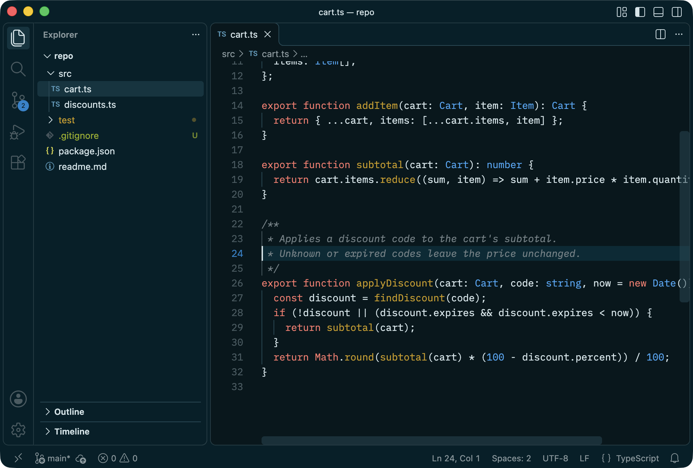
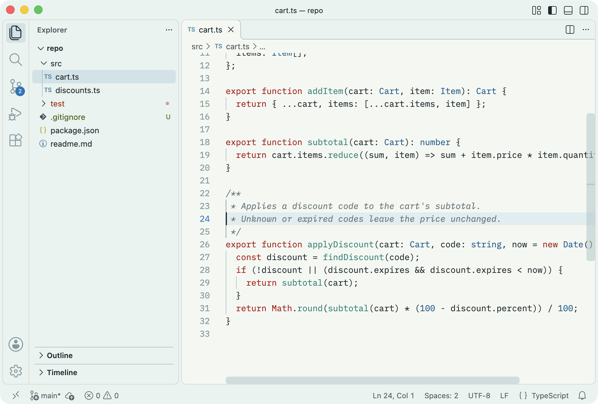

# Darkstar

Darkstar is a colour palette that's a descendant of
[Solarized](https://ethanschoonover.com/solarized/), with two themes: Darkstar
for dark mode and Lightstar for light mode.





## What's different from Solarized

- **Readable contrast.** Every colour reaches at least WCAG AA against the
  background, so no colour disappears when a program uses it as text.
- **Real bright colours.** Each colour's bright variant is a brighter version
  of itself rather than a grey, so "bright blue" is actually blue.
- **Still feels like Solarized.** The accent colours keep Solarized's hues as
  closely as they can.

## Switching with your system

To use Darkstar in dark mode and Lightstar in light mode, add this to your
settings:

```json
"window.autoDetectColorScheme": true,
"workbench.preferredDarkColorTheme": "Darkstar",
"workbench.preferredLightColorTheme": "Lightstar"
```

## Other apps

Darkstar is also available for Ghostty, Neovim, Helix, Zed, Zellij, Lazygit,
OpenCode, Chrome and Firefox. See
[the Darkstar repo](https://github.com/henrycatalinismith/darkstar).

## License

MIT
